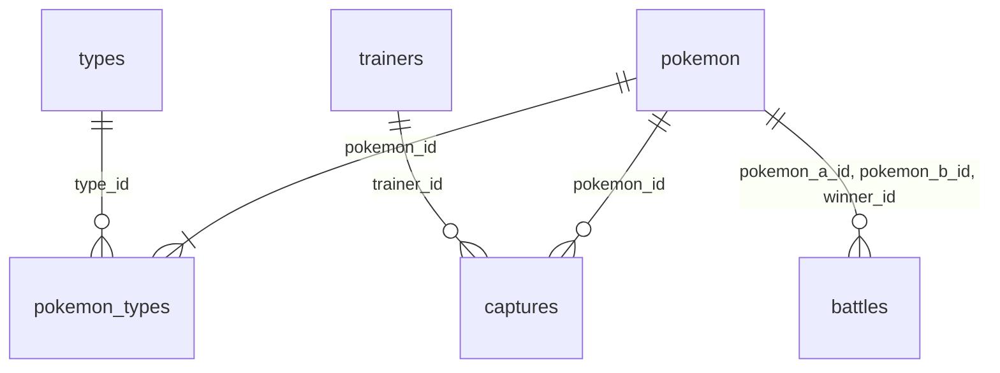

# Pokemon

Monorepo Nx con pnpm.

| Proyecto                   | Ruta               | Qué es                                                                |
| -------------------------- | ------------------ | --------------------------------------------------------------------- |
| `@pokemon/pokemon`         | `apps/pokemon`     | Web (SPA): React 19 · Vite 8 · React Router 8 · Redux Toolkit · MUI 9 |
| `@pokemon/api`             | `apps/api`         | API: NestJS 12 (ESM) · Zod                                            |
| `@pokemon/pokemon-e2e`     | `apps/pokemon-e2e` | Tests e2e (Playwright)                                                |
| `@pokemon/context-pokedex` | `context/pokedex`  | Lógica de negocio hexagonal ([README](context/pokedex/README.md))     |
| `@pokemon/db-main`         | `db/main`          | Prisma 7 + PostgreSQL ([README](db/main/README.md))                   |
| `@pokemon/ops`             | `platform/ops`     | CLI de operaciones (`pnpm ops`), sin dependencias                     |

## Requisitos

Node 24 (`nvm use`, ver `.nvmrc`), pnpm 10 (`corepack enable`), Docker y Python 3.10+ (solo para `pnpm ops data generate`; usa la librería estándar).

## Comandos

```sh
pnpm install
pnpm dev          # web en http://localhost:4200 y API en http://localhost:3000/api
pnpm build        # build de todos los proyectos
pnpm test         # tests unitarios (Vitest)
pnpm lint
pnpm typecheck
pnpm e2e          # Playwright (chromium, firefox, webkit)
```

Para un proyecto o target puntual: `pnpm nx run <proyecto>:<target>`. Lista de targets: `pnpm nx show project <proyecto>`.

La primera vez en una máquina, para el e2e: `pnpm exec playwright install --with-deps` (descarga los navegadores e instala sus librerías de sistema; pide sudo).

## Servicios (Docker)

Dos archivos de compose del mismo proyecto (`pokemon`), con el mismo `.env` de la raíz (plantilla: `.env.example`; si falta una variable, compose no arranca):

- `docker-compose.yml`, **todo el proyecto**: incluye `docker-compose.base.yml` y suma la API y la web en contenedores (ver [API y web en Docker](#api-y-web-en-docker)). Es lo que levanta `docker compose up`.
- `docker-compose.base.yml`, **solo la base**: PostgreSQL, las migraciones y Apache Airflow con la imagen oficial. Para desarrollar con `pnpm dev` (API y web fuera de Docker).

Al ser el mismo proyecto, comparten contenedores y volumen: lo que cargue el DAG se ve en los dos modos. La web en Docker usa el puerto 8000 y `pnpm dev` el 4200 y el 3000, así que pueden estar arriba a la vez.

Con los valores de la plantilla:

| Servicio      | Dónde                                    | Credenciales            |
| ------------- | ---------------------------------------- | ----------------------- |
| Web y API     | http://localhost:8000 (API en `/api`)    | —                       |
| PostgreSQL 18 | `localhost:5434`, db `pokemon`           | `postgres` / `postgres` |
| Airflow 3.3.2 | http://localhost:8080                    | `airflow` / `airflow`   |

```sh
cp .env.example .env                              # la primera vez
docker compose up -d --build                      # todo; la primera vez descarga ~2.6 GB de imágenes y Airflow tarda ~1 min en quedar listo
docker compose -f docker-compose.base.yml up -d   # solo Postgres, migraciones y Airflow (para pnpm dev)
docker compose down                               # detiene todo (en los dos modos); los datos quedan en el volumen
docker compose down -v                            # detiene y borra los datos
```

- Un solo Postgres con dos bases: `pokemon` (la app) y `airflow` (estado interno de Airflow, creada al iniciar el volumen).
- Orden de arranque: Postgres sano → `migrate` aplica las migraciones de Prisma (`db/main`: tablas y constraints) y termina → Airflow. El DAG no crea tablas: solo carga datos y crea las vistas.
- Airflow lee los CSV de `data/` (montada en solo lectura; se generan con `pnpm ops data prepare`) y escribe en la base `pokemon` con la conexión `pokemon_db`.
- Las vistas de las consultas se definen en `db/main/sql/views.sql` (montado en Airflow en solo lectura): el DAG las crea con ese archivo y la API las lee. Un test de contrato en `context/pokedex` verifica que ambos lados calcen.
- Airflow corre en modo `standalone`: UI/API, scheduler, dag-processor y triggerer en un contenedor, con LocalExecutor. Es el modo de Airflow para desarrollo local; si un componente se cae, el contenedor sigue arriba y queda `unhealthy` (`docker compose restart airflow`).
- Los DAGs van en `platform/airflow/dags/`. Un archivo nuevo tarda hasta 5 min en aparecer (los existentes se re-leen cada 30 s); para no esperar: `docker compose exec airflow airflow dags reserialize`.
- Usuarios, claves y bases de Postgres (también los de Airflow) se crean junto con el volumen: para cambiarlos después, `docker compose down -v`.
- El `DATABASE_URL` de `db/main/.env.example` y de `apps/api/.env.example` apunta a este Postgres, y `AIRFLOW_*` de `apps/api/.env.example` a este Airflow: si cambias el `.env` de la raíz, actualízalos también.

### API y web en Docker

- `docker-compose.yml` suma a la base `api` (`apps/api/Dockerfile`) y `web` (`apps/pokemon/Dockerfile`: la SPA servida con nginx, que reenvía `/api` a la API; mismo origen, sin CORS). Son imágenes de producción: después de cambiar código, `docker compose up -d --build` las reconstruye.
- La API no publica puerto: se llega por `http://localhost:8000/api` (`WEB_PORT`).
- Variables propias en el `.env`: `WEB_PORT` y `API_CORS_ALLOW_ORIGINS` (la API en producción no acepta `*`). La API usa además `POSTGRES_*` y `AIRFLOW_ADMIN_*`.
- La imagen de la API conserva la estructura del workspace: Node ejecuta `context/` y `db/main` como TypeScript y no quita tipos dentro de `node_modules`.

## API

`apps/api`, prefijo `/api` (en dev, `http://localhost:3000/api`). Lee la base `pokemon` (`DATABASE_URL`).

| Endpoint                            | Devuelve                                                                   |
| ----------------------------------- | -------------------------------------------------------------------------- |
| `GET /items?page=&pageSize=`        | Pokémon con sus tipos, paginado (`page` ≥ 1, `pageSize` 1–100, default 20) |
| `GET /items/:id`                    | Un Pokémon con sus tipos                                                   |
| `GET /items/summary`                | Por tipo: cantidad de Pokémon y experiencia base promedio                  |
| `GET /reports/monthly-growth`       | Consulta A: capturas por mes y % de cambio vs. el mes anterior             |
| `GET /reports/top-trainers`         | Consulta B: top 3 entrenadores por capturas en cada región                 |
| `GET /reports/level-classification` | Consulta C: por tipo, capturas con nivel ≥ 50 y su porcentaje              |
| `POST /etl/runs`                    | Dispara el DAG `pokemon_etl` en Airflow; 202 con la corrida encolada       |

Errores: entrada inválida → 400, id inexistente → 404, datos aún no disponibles (la vista no existe) → 503, Airflow no responde → 503, Airflow responde un error → 502. Las agregaciones (summary y A, B, C) corren en Postgres: cada endpoint lee una vista definida en `db/main/sql/views.sql` (contrato en [context/pokedex](context/pokedex/README.md)).

## Estructura de datos

| Carpeta             | Para qué                                                                                   |
| ------------------- | ------------------------------------------------------------------------------------------ |
| `data/`             | CSV de entrada que lee Airflow (no se versiona)                                            |
| `scripts/`          | Scripts que producen esos CSV                                                              |
| `platform/airflow/` | DAG `pokemon_etl` y su validación (`dags/`), tests en `tests/`                             |
| `platform/ops/`     | CLI `pnpm ops`: comandos en `src/commands/` (registrados en `index.ts`), tests en `tests/` |

```sh
pnpm ops data scrape      # PokeAPI → data/pokemon.csv, types.csv, pokemon_types.csv (Pokémon 1–100; --limit para otro n)
pnpm ops data generate    # scripts/generate_pokemon_data.py con los ids de data/pokemon.csv → trainers.csv, captures.csv, battles.csv
pnpm ops data prepare     # los dos anteriores en cadena: los 6 CSV juntos (data/ cambia solo si ambos terminan)
pnpm ops help
```

## Carga de datos (Airflow)

El DAG `pokemon_etl` es la única vía por la que entran datos a la base: no hay seeds ni dumps. Para que la app muestre datos:

```sh
pnpm ops data prepare          # 1. genera los 6 CSV en data/ (Airflow la monta en solo lectura)
docker compose up -d --build   # 2. Postgres, migraciones (crean las tablas), Airflow, API y web
```

Para desarrollar, en vez del paso 2: `docker compose -f docker-compose.base.yml up -d` y `pnpm dev` (web en `:4200`, API en `:3000`).

3. Disparar el DAG (no tiene schedule), de cualquiera de estas formas:
   - **Web** (http://localhost:8000): con la base vacía, cada sección muestra «Cargar datos»; a los pocos segundos, «Reintentar».
   - **API**: `curl -X POST http://localhost:8000/api/etl/runs` (con `pnpm dev`, `http://localhost:3000/api/etl/runs`).
   - **Airflow**: http://localhost:8080 → `pokemon_etl` → Trigger, o `docker compose exec airflow airflow dags trigger pokemon_etl`.

Tareas, en orden (tarda unos segundos):

1. `validate` lee los 6 CSV y los valida (`platform/airflow/dags/pokemon_csv.py`). La corrida falla, sin escribir nada, si falta un archivo, una columna o filas; si un valor está vacío o no se puede leer; si se repite un id o una clave única; si una referencia apunta a un id que no existe (`pokemon_id` y `trainer_id` de `captures.csv`, y las demás FK); o si una fila de `types`, `pokemon`, `pokemon_types` o `trainers` rompe una regla de la base. En `captures` y `battles`, que ninguna tabla referencia, una fila que rompe una regla se descarta y queda en el log (el generador produce algunas batallas con duración negativa). Un `base_experience` vacío (la PokeAPI lo trae `null` en algunos Pokémon) se carga como 0, el default de la columna. La columna `sprite` del CSV se carga en `sprite_url`.
2. `load` vacía las 6 tablas y las carga en orden de FK (`types`, `pokemon`, `pokemon_types`, `trainers`, `captures`, `battles`) en una sola transacción. Es idempotente: otra corrida deja exactamente los mismos datos, y si algo falla la base queda como estaba.
3. `build_views` crea o actualiza las vistas de las consultas con `db/main/sql/views.sql`.

Tests de la validación (Python 3.10+ con pytest; no necesitan Airflow): `python3 -m pytest platform/airflow`.

## Esquema de la base

Tablas y constraints en las migraciones de Prisma (`db/main/prisma`); vistas en `db/main/sql/views.sql` (contrato en [context/pokedex](context/pokedex/README.md)).



| Tabla           | Columnas                                                                                             | Clave primaria            | Claves foráneas y reglas                                                              |
| --------------- | ---------------------------------------------------------------------------------------------------- | ------------------------- | ------------------------------------------------------------------------------------- |
| `types`         | `id`, `name`                                                                                         | `id`                      | `name` único y no vacío                                                               |
| `pokemon`       | `id` (n° de Pokédex), `name`, `height`, `weight`, `base_experience` (default 0), `sprite_url` (null) | `id`                      | `name` único y no vacío; `height` y `weight` > 0; `base_experience` ≥ 0               |
| `pokemon_types` | `pokemon_id`, `type_id`, `slot`                                                                      | (`pokemon_id`, `type_id`) | → `pokemon`, → `types`; (`pokemon_id`, `slot`) único; `slot` 1 o 2, y el 2 exige el 1 |
| `trainers`      | `id`, `name`, `region`, `created_at` (fecha)                                                         | `id`                      | `name` y `region` no vacíos                                                           |
| `captures`      | `id`, `trainer_id`, `pokemon_id`, `captured_at` (timestamp), `level`, `location`                     | `id`                      | → `trainers`, → `pokemon`; `level` entre 1 y 100; `location` no vacía                 |
| `battles`       | `id`, `pokemon_a_id`, `pokemon_b_id`, `winner_id`, `fought_at` (timestamp), `duration_seconds`       | `id`                      | las tres → `pokemon`; A ≠ B; el ganador es A o B; `duration_seconds` ≥ 0              |

## Arquitectura

- **app** (`apps/`): hoy ninguna depende de un context ni db.
  - `pokemon` (web): SPA de Vite. Habla con la API solo por HTTP en `/api` (en dev, el proxy de Vite lo manda a `:3000`). Estado en Redux Toolkit (`src/app/store.ts`, un slice por feature en `src/features/`), rutas en `src/routes.tsx`, UI con MUI.
  - `api`: NestJS. Es quien arma los casos de uso de un context con sus adapters, un módulo por área en `src/modules/`. Prefijo global `/api`. El entorno se valida con Zod al arrancar (`src/config/env.ts`, variables en `apps/api/.env.example`); si no cumple, no arranca. El input de una ruta se valida con un schema de Zod: `@Query({ schema })`, `@Body({ schema })` (pipe global `StandardSchemaValidationPipe`).
- Los tests de cada app van en `tests/`, espejo de `src/`.
- **context** (`context/<nombre>`): `domain` → `application` (ports y casos de uso) → `infra/adapters`. Un context no importa a otro.
- **db** (`db/<nombre>`): schema, migraciones y cliente de Prisma. (`data/` queda para los CSV que consume Airflow.)
- **lib** (`libs/`): código compartido.
- **platform** (`platform/`): lo operativo, que no importa nadie: `ops` (CLI, tag `tool`) y `airflow` (DAGs en Python).

Los límites los aplica `@nx/enforce-module-boundaries` (`eslint.config.mjs`) según los tags `type:` (`app`, `e2e`, `context`, `db`, `lib`, `tool`) de `nx.tags` en el `package.json` de cada proyecto. Un proyecto sin tags no puede importar nada.

Nuevo context: `pnpm nx g @nx/js:lib context/<nombre> --name=@pokemon/context-<nombre> --bundler=none --unitTestRunner=vitest --linter=eslint --tags=type:context,scope:<nombre>`; para consumirlo, agrégalo con `workspace:*` al `package.json` de quien lo use y corre `pnpm nx sync`.

## Notas

- Los targets los infieren los plugins de `nx.json`. Declarados a mano: `generate` (cliente de Prisma, antes de `build`, `dev`, `test` y `typecheck` de quien dependa de `db`) y, en la API, `build`/`dev`/`start`, que son los scripts de su `package.json` (Nest CLI: compila con `tsc` a `apps/api/dist`).
- La API es ESM, como el resto: imports relativos con `.ts`, que `tsc` reescribe a `.js` (`rewriteRelativeImportExtensions`). Vitest (Oxc) emite la metadata de los decoradores, así que la inyección por tipo funciona en los tests sin SWC.
- Nx, TypeScript, ESLint y Vitest se actualizan con `pnpm nx migrate latest`, para no adelantarse a lo que soportan los plugins de Nx. `prisma` va fijo a `^7`: en npm, `latest` apunta a un release candidate de la 8.
