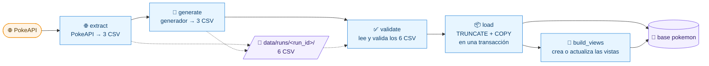
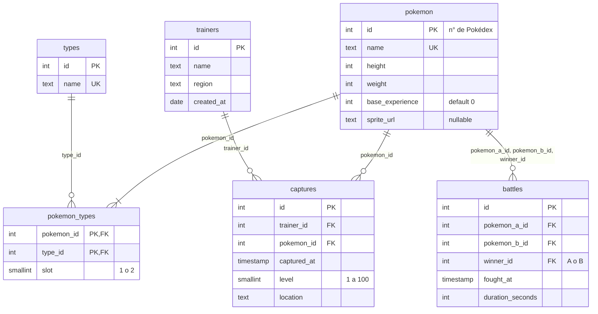
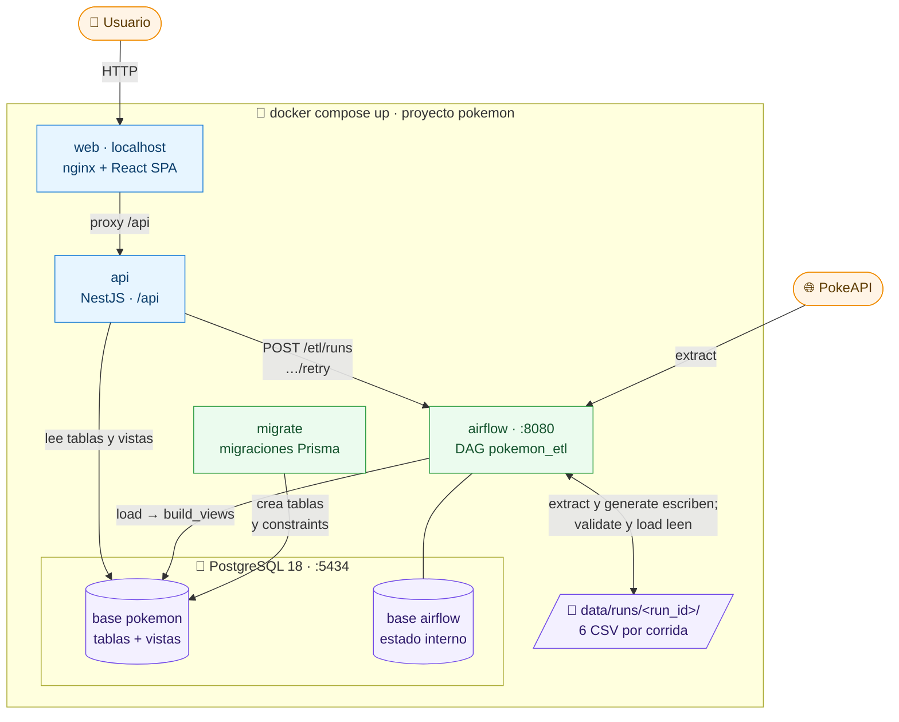
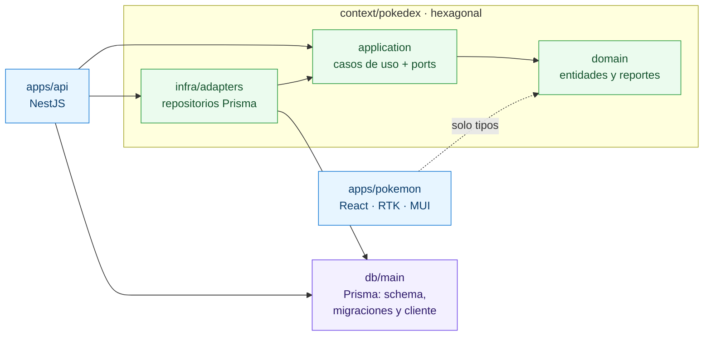

<div align="center">

# Pokémon Explorer

**PokeAPI → CSV → Airflow → PostgreSQL → API → Web**

Pokédex full-stack: un script baja los Pokémon a CSV, un DAG de Airflow los valida y los carga en PostgreSQL, y una web en React los muestra a través de una API propia en NestJS.


| 🚀 [Cómo correrlo](#-cómo-correrlo) | ⚡ [Disparar el DAG](#-disparar-el-dag) | 🐘 [Esquema de la base](#-esquema-de-la-base) | 🧩 [Arquitectura](#-arquitectura) |
| :---------------------------------: | :-------------------------------------: | :-------------------------------------------: | :-------------------------------: |

</div>

## 🚀 Cómo correrlo

**Requisitos:** Docker con Compose v2, Node 24 (`nvm use`, ver `.nvmrc`) y pnpm 10 (`corepack enable`). Python 3.10+ solo si quieres generar los CSV en tu máquina con `pnpm ops` (opcional, ver [Datos de entrada](#-datos-de-entrada)).

```sh
cp .env.example .env           # 1. variables: puertos, usuarios, claves y AIRFLOW_UID (tu `id -u`)
docker compose up -d --build   # 2. Postgres, migraciones, Airflow, API y web
```

**3.** Abrir **http://localhost** y apretar **«Cargar datos»**: dispara el DAG, que baja los datos de la PokeAPI, genera los sintéticos y llena la base ([otras formas](#-disparar-el-dag)).

> [!IMPORTANT]
> La base parte vacía: el DAG es la única vía por la que entran datos (no hay seeds ni dumps). Hasta que corra, cada sección de la web muestra «Cargar datos».

> [!NOTE]
> La primera vez, `docker compose up` descarga ~2.6 GB de imágenes, y Airflow tarda ~1 min en quedar listo.

Con los valores de `.env.example`:

| Servicio      | Dónde                            | Credenciales            |
| ------------- | -------------------------------- | ----------------------- |
| Web           | http://localhost                 | —                       |
| API           | http://localhost/api             | —                       |
| Airflow 3.3.2 | http://localhost:8080            | `airflow` / `airflow`   |
| PostgreSQL 18 | `localhost:5434`, base `pokemon` | `postgres` / `postgres` |

```sh
docker compose down      # detiene todo; los datos quedan en el volumen
docker compose down -v   # detiene y borra los datos
```

### Modo desarrollo

La API y la web corren fuera de Docker, con recarga en caliente; Docker levanta solo la base:

```sh
pnpm install
docker compose -f docker-compose.base.yml up -d   # Postgres, migraciones y Airflow
pnpm dev                                          # web en http://localhost:4200 y API en http://localhost:3000/api
```

| Archivo                   | Levanta                                                     | Para qué                         |
| ------------------------- | ----------------------------------------------------------- | -------------------------------- |
| `docker-compose.yml`      | `docker-compose.base.yml` + `api` y `web` en contenedores   | Correr todo: `docker compose up` |
| `docker-compose.base.yml` | `postgres`, `migrate` (Prisma) y `airflow` (imagen oficial) | Desarrollar con `pnpm dev`       |

Los dos son el mismo proyecto de compose (`pokemon`), así que comparten contenedores y volumen: lo que cargue el DAG se ve en los dos modos. La web en Docker usa el puerto 80 y `pnpm dev` el 4200 y el 3000, así que pueden estar arriba a la vez.

<details>
<summary><b>Detalles de Docker</b></summary>

- Ambos archivos leen el `.env` de la raíz (plantilla: `.env.example`); si falta una variable, compose no arranca. `WEB_PORT` y `API_CORS_ALLOW_ORIGINS` solo los usa `docker-compose.yml` (la API en producción no acepta `*`).
- La web se publica en `WEB_PORT=80`, así que la URL no lleva puerto. Si el 80 está ocupado, usa otro (p. ej. `WEB_PORT=8000`) y ponlo también en `API_CORS_ALLOW_ORIGINS` (`http://localhost:8000`).
- `api` (`apps/api/Dockerfile`) y `web` (`apps/pokemon/Dockerfile`) son imágenes de producción: después de cambiar código, `docker compose up -d --build` las reconstruye. La API no publica puerto: nginx la reenvía desde la web en `/api` (mismo origen, sin CORS), así que es la única puerta de entrada.
- La imagen de la API conserva la estructura del workspace: Node ejecuta `context/` y `db/main` como TypeScript y no quita tipos dentro de `node_modules`.
- Airflow corre en modo `standalone`: UI/API, scheduler, dag-processor y triggerer en un contenedor, con LocalExecutor. Es el modo de Airflow para desarrollo local; si un componente se cae, el contenedor sigue arriba y queda `unhealthy` (`docker compose restart airflow`).
- Airflow corre con el usuario `AIRFLOW_UID` (grupo 0, como pide la imagen oficial) para poder escribir los CSV en `./data`: tiene que ser el dueño de esa carpeta (`id -u`, en Linux suele ser 1000).
- Usuarios, claves y bases de Postgres (también los de Airflow) se crean junto con el volumen: para cambiarlos después, `docker compose down -v`.
- El `DATABASE_URL` de `db/main/.env.example` y de `apps/api/.env.example` apunta a este Postgres, y `AIRFLOW_*` de `apps/api/.env.example` a este Airflow: si cambias el `.env` de la raíz, actualízalos también.

</details>

## 📥 Datos de entrada

Los 6 CSV los produce **el propio DAG**, donde sea que corra Airflow (tu máquina o la nube): las tareas `extract` y `generate` los escriben en `data/runs/<run_id>/`, la carpeta de esa corrida dentro de `data/` (montada en Airflow con lectura y escritura), y `validate` y `load` los leen de ahí. Para actualizar los datos basta con disparar el DAG: no hay que generar nada a mano ni subir archivos. Se conservan las carpetas de las últimas 5 corridas. `data/` no se versiona.

Para desarrollo local, `pnpm ops` genera los mismos 6 CSV en tu máquina (byte a byte iguales a los del DAG), por ejemplo para revisarlos. El DAG no los usa.

```sh
pnpm ops data scrape      # PokeAPI → pokemon.csv, types.csv, pokemon_types.csv (Pokémon 1–100; --limit para otro n)
pnpm ops data generate    # scripts/generate_pokemon_data.py con los ids de data/pokemon.csv → trainers.csv, captures.csv, battles.csv
pnpm ops data prepare     # los dos en cadena: data/ cambia solo si ambos terminan
pnpm ops help
```

| CSV                 | Origen                                  | Columnas                                                                           |
| ------------------- | --------------------------------------- | ---------------------------------------------------------------------------------- |
| `pokemon.csv`       | PokeAPI                                 | `id`, `name`, `height`, `weight`, `base_experience`, `sprite`                      |
| `types.csv`         | PokeAPI                                 | `id`, `name`                                                                       |
| `pokemon_types.csv` | PokeAPI                                 | `pokemon_id`, `type_id`, `slot`                                                    |
| `trainers.csv`      | generador (50 entrenadores, 6 regiones) | `id`, `name`, `region`, `created_at`                                               |
| `captures.csv`      | generador (5.000 en 12 meses)           | `id`, `trainer_id`, `pokemon_id`, `captured_at`, `level`, `location`               |
| `battles.csv`       | generador (2.000)                       | `id`, `pokemon_a_id`, `pokemon_b_id`, `winner_id`, `fought_at`, `duration_seconds` |

- **Extracción**: en el DAG, `platform/airflow/dags/pokemon_extract.py` (Python, solo la librería estándar); en `pnpm ops`, `platform/ops` (TypeScript). Hacen lo mismo: cada request tiene un timeout de 15 s y hasta 4 intentos ante errores de red, 429 y 5xx, esperando una sola vez entre intentos (el `Retry-After` si viene; si no, 0,5 s, 1 s y 2 s). Cualquier otro status corta la extracción.
- **Generador** (`scripts/generate_pokemon_data.py`): el script del desafío, sin cambios (misma semilla y tamaños por defecto), con `--pokemon-csv` apuntando al `pokemon.csv` recién extraído.
- Los CSV de cada paso se escriben juntos al final (temporales y después rename): un fallo nunca deja archivos a medias.

## ⚡ Disparar el DAG

El DAG `pokemon_etl` no tiene schedule: se dispara a mano, de cualquiera de estas formas.

| Desde         | Cómo                                                                                                         |
| ------------- | ------------------------------------------------------------------------------------------------------------ |
| 🖱️ Web        | http://localhost → **«Cargar datos»** (aparece con la base vacía); a los pocos segundos, «Reintentar»        |
| 🌐 API        | `curl -X POST http://localhost/api/etl/runs` → `202` con la corrida encolada (con `pnpm dev`, puerto `3000`) |
| 🌀 Airflow UI | http://localhost:8080 (`airflow` / `airflow`) → `pokemon_etl` → **Trigger**                                  |
| 💻 CLI        | `docker compose exec airflow airflow dags trigger pokemon_etl`                                               |

Tarda unos segundos. Tareas, en orden:



1. **`extract`** baja los Pokémon 1–100 de la PokeAPI y escribe `pokemon.csv`, `types.csv` y `pokemon_types.csv` en la carpeta de la corrida. También borra las carpetas de corridas viejas (deja las últimas 5).
2. **`generate`** corre el generador con esos ids y escribe `trainers.csv`, `captures.csv` y `battles.csv`.
3. **`validate`** lee los 6 CSV y los valida (`platform/airflow/dags/pokemon_csv.py`). La corrida falla, sin escribir nada, si:
   - falta un archivo, una columna o filas;
   - un valor está vacío o no se puede leer;
   - se repite un id o una clave única;
   - una referencia apunta a un id que no existe (`pokemon_id` y `trainer_id` de `captures.csv`, y las demás FK);
   - una fila de `types`, `pokemon`, `pokemon_types` o `trainers` rompe una regla de la base.

   En `captures` y `battles`, que ninguna tabla referencia, una fila que rompe una regla se descarta y queda en el log (el generador produce algunas batallas con duración negativa). Un `base_experience` vacío (la PokeAPI lo trae `null` en algunos Pokémon) se carga como 0, el default de la columna. La columna `sprite` del CSV se carga en `sprite_url`.

4. **`load`** vacía las 6 tablas y las carga en orden de FK (`types`, `pokemon`, `pokemon_types`, `trainers`, `captures`, `battles`) en una sola transacción. Es **idempotente**: otra corrida deja exactamente los mismos datos, y si algo falla la base queda como estaba.
5. **`build_views`** crea o actualiza las vistas de las consultas con `db/main/sql/views.sql`.

### Retomar sin repetir pasos

Airflow guarda el estado de cada tarea, y cada una deja su resultado en la carpeta de la corrida: al retomar, **solo se vuelve a correr lo que no terminó**.

| Qué pasa                                                  | Qué hace el DAG                                                                                                                                                   |
| --------------------------------------------------------- | ----------------------------------------------------------------------------------------------------------------------------------------------------------------- |
| Falla pasajera (PokeAPI caída, base que no responde)      | Reintenta **esa tarea** sola, hasta 3 veces (esperando 15 s, 30 s y 60 s)                                                                                         |
| Airflow se cae a mitad de una tarea                       | Al volver, la tarea queda huérfana y el scheduler la retoma en ~1 min (`ORPHANED_TASKS_CHECK_INTERVAL` y `TASK_INSTANCE_HEARTBEAT_TIMEOUT` en 60 s en el compose) |
| Error que reintentar no arregla (datos inválidos, un 404) | La corrida falla de una, sin gastar reintentos. Después de corregir, se retoma **la misma corrida** desde la tarea fallida                                        |

Para retomar una corrida fallida:

```sh
# el runId lo devuelve POST /api/etl/runs (trae ':' y '+': va codificado en la URL)
curl -X POST "http://localhost/api/etl/runs/$(jq -rn --arg id "$RUN_ID" '$id|@uri')/retry"
```

…o en la UI de Airflow: la corrida → la tarea fallida → **Clear** (con «Only failed» y «Downstream»). Las tareas que ya terminaron bien no se repiten. Lo comprobamos matando Airflow a mitad de `load`: al volver, `extract`, `generate` y `validate` siguieron en su primer intento y solo se repitió `load`.

> [!TIP]
> Un archivo de DAG nuevo tarda hasta 5 min en aparecer en Airflow (los existentes se re-leen cada 30 s). Para no esperar: `docker compose exec airflow airflow dags reserialize`.

## 🐘 Esquema de la base

Tablas y constraints en las migraciones de Prisma (`db/main/prisma`); vistas en `db/main/sql/views.sql`, que crea el DAG (contrato en [context/pokedex](context/pokedex/README.md)).



| Tabla           | Clave primaria            | Claves foráneas                                         | Reglas                                                                  |
| --------------- | ------------------------- | ------------------------------------------------------- | ----------------------------------------------------------------------- |
| `types`         | `id`                      | —                                                       | `name` único y no vacío                                                 |
| `pokemon`       | `id` (n° de Pokédex)      | —                                                       | `name` único y no vacío; `height` y `weight` > 0; `base_experience` ≥ 0 |
| `pokemon_types` | (`pokemon_id`, `type_id`) | → `pokemon`, → `types`                                  | (`pokemon_id`, `slot`) único; `slot` 1 o 2, y el 2 exige el 1           |
| `trainers`      | `id`                      | —                                                       | `name` y `region` no vacíos                                             |
| `captures`      | `id`                      | → `trainers`, → `pokemon`                               | `level` entre 1 y 100; `location` no vacía                              |
| `battles`       | `id`                      | `pokemon_a_id`, `pokemon_b_id`, `winner_id` → `pokemon` | A ≠ B; el ganador es A o B; `duration_seconds` ≥ 0                      |

Vistas (las agregaciones corren en Postgres; la API solo las lee):

| Vista                          | Endpoint                            | Qué calcula                                                                         |
| ------------------------------ | ----------------------------------- | ----------------------------------------------------------------------------------- |
| `type_summary`                 | `GET /items/summary`                | Por tipo: cantidad de Pokémon y experiencia base promedio                           |
| `capture_monthly_growth`       | `GET /reports/monthly-growth`       | **Consulta A**: capturas por mes y % de cambio vs. el mes anterior                  |
| `top_trainers_by_region`       | `GET /reports/top-trainers`         | **Consulta B**: top 3 entrenadores por capturas en cada región (función de ventana) |
| `level_classification_by_type` | `GET /reports/level-classification` | **Consulta C**: por tipo, capturas con nivel ≥ 50 y su porcentaje                   |

## 🧩 Arquitectura



- **Orden de arranque:** Postgres sano → `migrate` aplica las migraciones de Prisma (tablas y constraints) y termina → Airflow, API y web. El DAG no crea tablas: genera los CSV, los carga y crea las vistas.
- **Un solo Postgres con dos bases:** `pokemon` (la app; Airflow escribe con la conexión `pokemon_db` y la API lee) y `airflow` (estado interno de Airflow, creada al iniciar el volumen).
- **Una sola definición de las vistas:** `db/main/sql/views.sql`, montado en Airflow en solo lectura. El DAG las crea con ese archivo y la API las lee; un test de contrato en `context/pokedex` verifica que ambos lados calcen.
- **Web** (`apps/pokemon`): SPA de Vite con React Router (`/items`, `/item/:id` y `/reports/*`), estado y caché de respuestas en Redux Toolkit, UI con MUI. Habla con la API solo por HTTP en `/api` (en Docker, nginx la reenvía; en dev, el proxy de Vite a `:3000`).
- **API** (`apps/api`): NestJS. Lee la base con los repositorios de `context/pokedex` y dispara el DAG con la API REST de Airflow; no espera a que termine.

### Código (monorepo Nx con pnpm)



| Proyecto                   | Ruta               | Qué es                                                                |
| -------------------------- | ------------------ | --------------------------------------------------------------------- |
| `@pokemon/pokemon`         | `apps/pokemon`     | Web (SPA): React 19 · Vite 8 · React Router 8 · Redux Toolkit · MUI 9 |
| `@pokemon/api`             | `apps/api`         | API: NestJS 12 (ESM) · Zod                                            |
| `@pokemon/pokemon-e2e`     | `apps/pokemon-e2e` | Tests e2e (Playwright)                                                |
| `@pokemon/context-pokedex` | `context/pokedex`  | Lógica de negocio hexagonal ([README](context/pokedex/README.md))     |
| `@pokemon/db-main`         | `db/main`          | Prisma 7 + PostgreSQL ([README](db/main/README.md))                   |
| `@pokemon/ops`             | `platform/ops`     | CLI de operaciones (`pnpm ops`), sin dependencias                     |

Además: `platform/airflow/` (DAG `pokemon_etl`, su extracción y su validación en `dags/`, tests en `tests/`), `scripts/` (el generador, que corre el DAG) y `data/` (los CSV de cada corrida, no se versiona).

- **app** (`apps/`):
  - `pokemon` (web): estado en Redux Toolkit (`src/app/store.ts`, un slice por feature en `src/features/`), rutas en `src/routes.tsx`. De `context/pokedex` importa solo tipos (no entran al bundle), así web y API comparten el contrato.
  - `api`: es quien arma los casos de uso de un context con sus adapters, un módulo por área en `src/modules/`. Prefijo global `/api`. El entorno se valida con Zod al arrancar (`src/config/env.ts`, variables en `apps/api/.env.example`); si no cumple, no arranca. El input de una ruta se valida con un schema de Zod: `@Query({ schema })`, `@Body({ schema })` (pipe global `StandardSchemaValidationPipe`).
- **context** (`context/<nombre>`): `domain` → `application` (ports y casos de uso) → `infra/adapters` (Repository Pattern sobre Prisma). Un context no importa a otro.
- **db** (`db/<nombre>`): schema, migraciones y cliente de Prisma.
- **lib** (`libs/`): código compartido.
- **platform** (`platform/`): lo operativo, que no importa nadie: `ops` (CLI, tag `tool`) y `airflow` (DAGs en Python).
- Los tests de cada proyecto van en `tests/`, espejo de `src/`.

Los límites los aplica `@nx/enforce-module-boundaries` (`eslint.config.mjs`) según los tags `type:` (`app`, `e2e`, `context`, `db`, `lib`, `tool`) de `nx.tags` en el `package.json` de cada proyecto. Un proyecto sin tags no puede importar nada.

## 🔌 API

`apps/api`, prefijo `/api` (en Docker, `http://localhost/api`, vía nginx; con `pnpm dev`, `http://localhost:3000/api`). Lee la base `pokemon` (`DATABASE_URL`).

| Endpoint                            | Devuelve                                                                   |
| ----------------------------------- | -------------------------------------------------------------------------- |
| `GET /items?page=&pageSize=`        | Pokémon con sus tipos, paginado (`page` ≥ 1, `pageSize` 1–100, default 20) |
| `GET /items/:id`                    | Un Pokémon con sus tipos                                                   |
| `GET /items/summary`                | Por tipo: cantidad de Pokémon y experiencia base promedio                  |
| `GET /reports/monthly-growth`       | Consulta A: capturas por mes y % de cambio vs. el mes anterior             |
| `GET /reports/top-trainers`         | Consulta B: top 3 entrenadores por capturas en cada región                 |
| `GET /reports/level-classification` | Consulta C: por tipo, capturas con nivel ≥ 50 y su porcentaje              |
| `POST /etl/runs`                    | Dispara el DAG `pokemon_etl` en Airflow; `202` con la corrida encolada     |
| `POST /etl/runs/:runId/retry`       | Retoma esa corrida desde sus tareas fallidas; `202` con la corrida         |

| Caso                                          | Código |
| --------------------------------------------- | :----: |
| Entrada inválida                              | `400`  |
| Id o corrida inexistente                      | `404`  |
| Retry de una corrida sin tareas fallidas      | `409`  |
| Datos aún no disponibles (la vista no existe) | `503`  |
| Airflow no responde                           | `503`  |
| Airflow responde un error                     | `502`  |

## 🔧 Desarrollo

```sh
pnpm install
pnpm dev          # web en http://localhost:4200 y API en http://localhost:3000/api (con docker-compose.base.yml arriba)
pnpm build        # build de todos los proyectos
pnpm test         # tests unitarios (Vitest)
pnpm lint
pnpm typecheck
pnpm e2e          # Playwright (chromium, firefox, webkit)
python3 -m pytest platform/airflow   # tests de la validación del DAG (no necesitan Airflow)
```

- Para un proyecto o target puntual: `pnpm nx run <proyecto>:<target>`. Lista de targets: `pnpm nx show project <proyecto>`.
- La primera vez en una máquina, para el e2e: `pnpm exec playwright install --with-deps` (descarga los navegadores e instala sus librerías de sistema; pide sudo).
- Los DAGs van en `platform/airflow/dags/`.

<details>
<summary><b>Notas</b></summary>

- Nuevo context: `pnpm nx g @nx/js:lib context/<nombre> --name=@pokemon/context-<nombre> --bundler=none --unitTestRunner=vitest --linter=eslint --tags=type:context,scope:<nombre>`; para consumirlo, agrégalo con `workspace:*` al `package.json` de quien lo use y corre `pnpm nx sync`.
- Los targets los infieren los plugins de `nx.json`. Declarados a mano: `generate` (cliente de Prisma, antes de `build`, `dev`, `test` y `typecheck` de quien dependa de `db`) y, en la API, `build`/`dev`/`start`, que son los scripts de su `package.json` (Nest CLI: compila con `tsc` a `apps/api/dist`).
- La API es ESM, como el resto: imports relativos con `.ts`, que `tsc` reescribe a `.js` (`rewriteRelativeImportExtensions`). Vitest (Oxc) emite la metadata de los decoradores, así que la inyección por tipo funciona en los tests sin SWC.
- Nx, TypeScript, ESLint y Vitest se actualizan con `pnpm nx migrate latest`, para no adelantarse a lo que soportan los plugins de Nx. `prisma` va fijo a `^7`: en npm, `latest` apunta a un release candidate de la 8.

</details>
