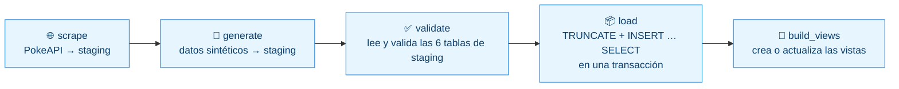
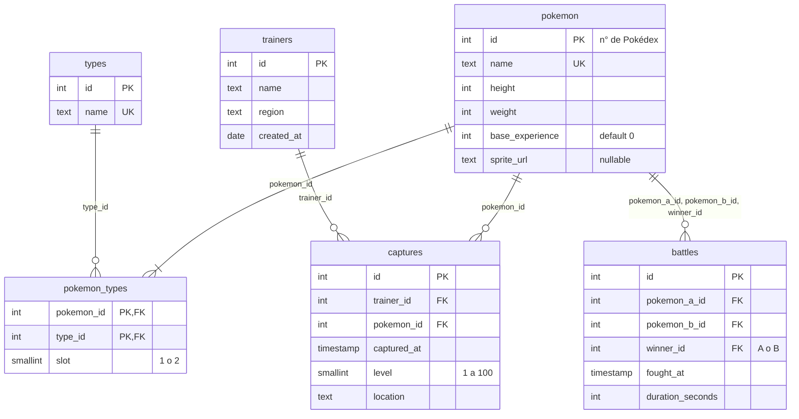
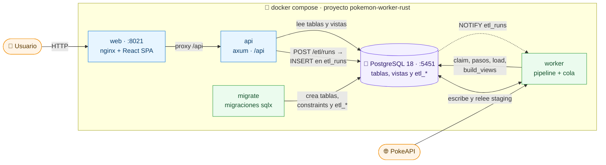
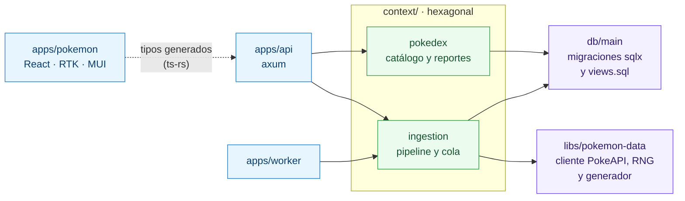

> [!NOTE]
> **Alternativa `worker-rust`.** Esta carpeta (`alternatives/worker-rust` del repo principal) es una copia autónoma del proyecto donde **todo el backend está en Rust** y **un worker reemplaza a Apache Airflow**: el worker es quien baja los datos, los genera, los valida y los carga. Solo la web (React) y los tests e2e (Playwright) siguen en TypeScript. No está conectada al proyecto principal: **todos los comandos de este README se corren desde esta carpeta** (cargo, pnpm, Nx y docker compose usan las configuraciones de aquí).

<div align="center">

# Pokémon Explorer

**PokeAPI → worker → PostgreSQL (staging → tablas) → API → Web**

Pokédex full-stack: un worker en Rust baja los Pokémon de la PokeAPI, genera los datos sintéticos, los valida y los carga en PostgreSQL; una web en React los muestra a través de una API propia en axum.


| 🚀 [Cómo correrlo](#-cómo-correrlo) | ⚙️ [El worker](#️-el-worker) | 🐘 [Esquema de la base](#-esquema-de-la-base) | 🧩 [Arquitectura](#-arquitectura) |
| :---------------------------------: | :-------------------------: | :-------------------------------------------: | :-------------------------------: |

</div>

## 🚀 Cómo correrlo

**Requisitos:** Docker con Compose v2, Node 24 (`nvm use`, ver `.nvmrc`) y pnpm 10 (`corepack enable`) para la web y Nx. Para compilar el backend fuera de Docker, Rust 1.99 (`rustup` instala solo la versión de `rust-toolchain.toml`).

```sh
cp .env.example .env           # 1. variables: puertos, usuario y clave
docker compose up -d --build   # 2. Postgres, migraciones, API, worker y web
```

**3.** Abrir **http://localhost:8021** y apretar **«Cargar datos»**: encola una corrida y el worker llena la base ([otras formas](#-disparar-una-corrida)).

> [!IMPORTANT]
> La base parte vacía: las corridas del worker son la única vía por la que entran datos (no hay seeds ni dumps). Hasta que una termine, cada sección de la web muestra «Cargar datos».

> [!NOTE]
> La primera vez, el build de las imágenes compila todo el backend en Rust (varios minutos). Una corrida con PokeAPI real tarda unos segundos.

Con los valores de `.env.example`:

| Servicio      | Dónde                            | Credenciales            |
| ------------- | -------------------------------- | ----------------------- |
| Web           | http://localhost:8021            | —                       |
| API           | http://localhost:8021/api        | —                       |
| PostgreSQL 18 | `localhost:5451`, base `pokemon` | `postgres` / `postgres` |

```sh
docker compose down      # detiene todo; los datos quedan en el volumen
docker compose down -v   # detiene y borra los datos
```

### Modo desarrollo

La API, el worker y la web corren fuera de Docker, con recarga en caliente de la web; Docker levanta solo la base:

```sh
pnpm install
docker compose -f docker-compose.base.yml up -d   # Postgres y migraciones
pnpm dev                                          # web en :4200, API en :3000/api y worker (cargo run)
```

Las variables de la API y del worker en desarrollo tienen valores por defecto que calzan con `.env.example`; para cambiarlas, copia `apps/api/.env.example` y `apps/worker/.env.example` a `.env` (en esa carpeta o en la raíz). En producción (`APP_ENV=production`) no se lee ningún `.env`.

| Archivo                   | Levanta                                                     | Para qué                         |
| ------------------------- | ----------------------------------------------------------- | -------------------------------- |
| `docker-compose.yml`      | `docker-compose.base.yml` + `api`, `worker` y `web`         | Correr todo: `docker compose up` |
| `docker-compose.base.yml` | `postgres` y `migrate` (migraciones de sqlx, imagen propia) | Desarrollar con `pnpm dev`       |

Los dos son el mismo proyecto de compose (`pokemon-worker-rust`), así que comparten contenedores y volumen: lo que cargue el worker se ve en los dos modos. La web en Docker usa el puerto 8021 y `pnpm dev` el 4200 y el 3000.

<details>
<summary><b>Detalles de Docker</b></summary>

- Ambos archivos leen el `.env` de la raíz (plantilla: `.env.example`); si falta una variable, compose no arranca. `WEB_PORT` y `API_CORS_ALLOW_ORIGINS` solo los usa `docker-compose.yml` (la API en producción no acepta `*`).
- Un solo `Dockerfile` en la raíz con tres targets (`api`, `worker` y `migrate`) que comparten la etapa de build: `cargo build --release --locked` de los tres binarios con caché de cargo. La imagen final es `debian:bookworm-slim` con `ca-certificates`, usuario `app` (uid 1000) y `APP_ENV=production`. La web (`apps/pokemon/Dockerfile`) sigue siendo nginx con la SPA.
- Después de cambiar código, `docker compose up -d --build` reconstruye las imágenes. La API no publica puerto: se llega por la web en `/api`. Su healthcheck es el propio binario: `pokemon-api healthcheck`.
- El worker no escribe archivos: los datos entre pasos viven en las tablas `staging` de Postgres.
- `migrate` aplica las migraciones y termina; `api` y `worker` esperan a que termine bien (`service_completed_successfully`).
- Usuario, clave y base de Postgres se crean junto con el volumen: para cambiarlos después, `docker compose down -v`.

</details>

## ⚙️ El worker

`apps/worker` es un proceso aparte que **posee todo el pipeline de datos**: `scrape → generate → validate → load → build_views`. La API solo encola corridas y consulta su estado; no ejecuta nada.



| Paso          | Lee                                    | Escribe                                                                  | `output` (se guarda en `etl_run_steps.output`)               |
| ------------- | -------------------------------------- | ------------------------------------------------------------------------ | ------------------------------------------------------------ |
| `scrape`      | PokeAPI, Pokémon `1..POKEMON_LIMIT`    | `staging.types`, `staging.pokemon`, `staging.pokemon_types`              | `{"pokemon", "types", "pokemonTypes"}` (cantidades)          |
| `generate`    | los ids de `staging.pokemon`           | `staging.trainers`, `staging.captures`, `staging.battles`                | `{"trainers", "captures", "battles"}`                        |
| `validate`    | las 6 tablas de `staging`              | nada                                                                     | `{"counts", "discarded"}` (motivos de las filas descartadas) |
| `load`        | las 6 tablas de `staging` (se releen y se validan) | las 6 tablas finales, en una transacción                     | `{"counts"}`                                                 |
| `build_views` | `db/main/sql/views.sql`                | las vistas                                                               | `null`                                                       |

- **`staging`** (migración `20261106000000_staging`) guarda los datos de la corrida entre un paso y el siguiente. Sus tablas no tienen PK, FK ni CHECK a propósito: la validación revisa todo antes de cargar y así informa cada problema en vez de fallar al insertar. Un paso ya `succeeded` no se repite: sus datos siguen ahí.
- **`scrape` y `generate`** reemplazan sus tablas de `staging` en una transacción (`TRUNCATE` + inserción masiva con `UNNEST`), con la verificación del fence justo antes del `COMMIT`. Si el paso se cancela, vence su plazo o pierde la lease antes del commit, la transacción se descarta y `staging` queda como estaba.
- **Plazos:** cada sentencia de un paso que usa la base tiene `statement_timeout` de 60 s y cada paso un plazo total de 5 minutos; al vencer, el paso se cancela sin escribir y el fallo es reintentable.
- **`generate`** es un port exacto del script Python del desafío: mismo generador Mersenne Twister de CPython y misma semilla, así que con los mismos Pokémon produce **las mismas filas** que producía antes (ver `libs/pokemon-data/tests`, con goldens del script original).
- **`validate`** lee las 6 tablas ordenadas por `id` y falla, sin escribir nada, si una tabla no tiene filas; un valor falta o está en blanco; se repite un id o clave única; una referencia apunta a un id que no existe; o una fila de `types`, `pokemon`, `pokemon_types` o `trainers` rompe una regla de la base. En `captures` y `battles`, que ninguna tabla referencia, una fila que rompe una regla se **descarta** y queda en el log y en el `output` (el generador produce algunas batallas con duración negativa). Un `base_experience` nulo se carga como 0.
- **`load`** relee y valida `staging` (lo que se carga es exactamente lo validado), vacía las 6 tablas finales y las llena en orden de FK con un `INSERT … SELECT` por tabla, sin las capturas y combates descartados, en una sola transacción. Es **idempotente**: otra corrida deja exactamente los mismos datos, y si algo falla la base queda como estaba.

### La cola

La tabla `etl_runs` es también la cola (no hay Redis ni broker). Estados de una corrida: `queued → running → succeeded | failed`, con `running → queued` cuando falla un paso por una causa transitoria y quedan intentos, y `failed → queued` en el reintento manual.

- **Una sola corrida activa:** un índice único parcial impide dos corridas `queued`/`running` a la vez. `POST /api/etl/runs` con otra ya en curso devuelve **esa misma corrida**, también si llegan dos disparos simultáneos.
- **Enqueue:** la corrida y sus 5 filas de `etl_run_steps` se crean en una transacción, así que el worker nunca ve una corrida sin pasos.
- **Aviso y polling:** un trigger hace `NOTIFY etl_runs` al encolar. El worker mantiene una conexión con `LISTEN etl_runs`, y además consulta cada `POLL_SECONDS`: el aviso solo adelanta el intento de tomar una corrida; si se pierde, el polling garantiza el avance.
- **Claim con `FOR UPDATE SKIP LOCKED`:** varios workers pueden convivir; solo uno obtiene cada corrida. Procesa una a la vez, y al terminar vuelve a intentar de inmediato.
- **Lease y heartbeat:** el claim pone `locked_until = now() + LEASE_SECONDS`. Un heartbeat independiente, cada `LEASE_SECONDS / 3`, la renueva. Si otro worker la tomó (porque este se detuvo y venció la lease), el heartbeat devuelve 0 filas: el worker deja de ejecutar y no escribe nada más. Si la base no responde, el plazo local manda: pasada la lease sin un heartbeat confirmado, también la da por perdida.
- **Fencing:** el contador `attempts` del claim es el _token_ de esa ejecución; cada transición de paso o de corrida lo exige en su `WHERE`. Antes del `COMMIT`, `scrape`, `generate` y `load` verifican con `FOR SHARE` que la lease sigue siendo suya; si no, hacen rollback: un paso zombi no puede pisar los datos que usa otro worker.
- **Reanudación:** un paso `succeeded` nunca se vuelve a ejecutar dentro de la misma corrida. Si el worker muere a mitad de camino, otro (o el mismo al reiniciar) reclama la corrida cuando vence la lease y sigue desde el paso interrumpido.
- **Reintentos automáticos:** una falla _transitoria_ (red, timeouts, 429/5xx, conexión caída) re-encola la corrida con espera creciente (5, 10, 20… hasta 60 s), hasta `max_attempts` (3). Una falla _permanente_ (datos inválidos, otro estado HTTP, errores de integridad de la base, configuración) la deja `failed` de inmediato. Una corrida que murió sin intentos restantes se marca `failed`.
- **Reintento manual:** `POST /api/etl/runs/:runId/retry` re-encola una corrida `failed` **conservando el estado de sus pasos**: continúa desde el paso que falló. Si el fallo fue en `validate` y ya corregiste `staging`, retoma ahí sin volver a bajar nada.
- **Apagado ordenado:** con SIGINT/SIGTERM deja de tomar corridas y da hasta 10 s al paso en curso: al terminarlo no empieza otro, y la corrida vuelve a la cola sin gastar un intento (el relevo no espera a que venza la lease). Si el paso no termina en 10 s, lo abandona y devuelve igualmente la corrida a la cola. `stop_grace_period: 20s` en `docker-compose.yml` evita que Docker lo mate antes.
- **Logs** en español por stdout: claim, inicio y fin de cada paso con su resumen, filas descartadas (máximo 20 por tabla) y fallas con su clase.

## 📥 Disparar una corrida

| Desde  | Cómo                                                                                                                                                     |
| ------ | -------------------------------------------------------------------------------------------------------------------------------------------------------- |
| 🖱️ Web | http://localhost:8021 → **«Cargar datos»** (aparece con la base vacía); a los pocos segundos, «Reintentar»                                               |
| 🌐 API | `curl -X POST http://localhost:8021/api/etl/runs` → `202` con la corrida; `GET /api/etl/runs/<runId>` para ver sus pasos (con `pnpm dev`, puerto `3000`) |

La corrida de ejemplo termina con los 5 pasos en `succeeded`. No hay otra forma de preparar los datos: solo el worker los produce (no hay archivos CSV ni CLI).

Cada request a la PokeAPI tiene un timeout de 15 s y hasta 4 intentos con espera creciente ante errores de red, 429 (respeta `Retry-After`) y 5xx; cualquier otro error corta la extracción. Hasta 8 requests en vuelo.

### Variables de entorno del worker

| Variable        | Defecto                             | Qué es                                                 |
| --------------- | ----------------------------------- | ------------------------------------------------------ |
| `DATABASE_URL`  | `…localhost:5451/pokemon`           | Base de la app                                         |
| `POKEAPI_URL`   | `https://pokeapi.co/api/v2`         | Base de la PokeAPI                                     |
| `POKEMON_LIMIT` | `100`                               | Cuántos Pokémon se bajan (2..1025)                     |
| `WORKER_ID`     | `host:pid:hex aleatorio`            | Identifica al worker en `locked_by`                    |
| `LEASE_SECONDS` | `30`                                | Duración de la lease                                   |
| `POLL_SECONDS`  | `5`                                 | Cada cuánto consulta la cola aunque no llegue un aviso |
| `APP_ENV`       | `development`                       | `production` desactiva la lectura de `.env`            |

Un valor inválido hace que el proceso no arranque, con un mensaje que nombra la variable.

## 🐘 Esquema de la base

Tablas y constraints en las migraciones de sqlx (`db/main/migrations`, que aplica el servicio `migrate`); vistas en `db/main/sql/views.sql`, que crea el paso `build_views` y que el crate `pokemon-db` embebe con `include_str!`.



| Tabla           | Clave primaria            | Claves foráneas                                         | Reglas                                                                  |
| --------------- | ------------------------- | ------------------------------------------------------- | ----------------------------------------------------------------------- |
| `types`         | `id`                      | —                                                       | `name` único y no vacío                                                 |
| `pokemon`       | `id` (n° de Pokédex)      | —                                                       | `name` único y no vacío; `height` y `weight` > 0; `base_experience` ≥ 0 |
| `pokemon_types` | (`pokemon_id`, `type_id`) | → `pokemon`, → `types`                                  | (`pokemon_id`, `slot`) único; `slot` 1 o 2, y el 2 exige el 1           |
| `trainers`      | `id`                      | —                                                       | `name` y `region` no vacíos                                             |
| `captures`      | `id`                      | → `trainers`, → `pokemon`                               | `level` entre 1 y 100; `location` no vacía                              |
| `battles`       | `id`                      | `pokemon_a_id`, `pokemon_b_id`, `winner_id` → `pokemon` | A ≠ B; el ganador es A o B; `duration_seconds` ≥ 0                      |

Tablas del pipeline (migraciones `20261105000000_etl_runs` y `20261106000000_staging`):

| Tabla           | Clave primaria     | Qué guarda                                                                                                                                           |
| --------------- | ------------------ | ---------------------------------------------------------------------------------------------------------------------------------------------------- |
| `etl_runs`      | `id` (uuid)        | La corrida y la cola: `status`, `attempts` / `max_attempts`, `run_after`, `locked_by` / `locked_until` (la lease), `error` y las marcas de tiempo    |
| `etl_run_steps` | (`run_id`, `step`) | Los 5 pasos de cada corrida: `position`, `status`, `attempts`, `error`, `output` (JSONB) y las marcas de tiempo; se borran en cascada con su corrida |
| `staging.*`     | —                  | Las 6 tablas del dataset (`types`, `pokemon`, `pokemon_types`, `trainers`, `captures`, `battles`) sin restricciones: los datos de la corrida entre pasos |

Vistas (las agregaciones corren en Postgres; la API solo las lee):

| Vista                          | Endpoint                            | Qué calcula                                                                         |
| ------------------------------ | ----------------------------------- | ----------------------------------------------------------------------------------- |
| `type_summary`                 | `GET /items/summary`                | Por tipo: cantidad de Pokémon y experiencia base promedio                           |
| `capture_monthly_growth`       | `GET /reports/monthly-growth`       | **Consulta A**: capturas por mes y % de cambio vs. el mes anterior                  |
| `top_trainers_by_region`       | `GET /reports/top-trainers`         | **Consulta B**: top 3 entrenadores por capturas en cada región (función de ventana) |
| `level_classification_by_type` | `GET /reports/level-classification` | **Consulta C**: por tipo, capturas con nivel ≥ 50 y su porcentaje                   |

El test de contrato de `context/pokedex` (`tests/infra/adapters/pg_reports_repository.rs`) aplica las migraciones y ese mismo `views.sql` en una base propia, carga unos pocos datos y verifica lo que devuelve el adaptador: si una vista y el adaptador dejan de calzar, falla.

## 🧩 Arquitectura



- **Orden de arranque:** Postgres sano → `migrate` aplica las migraciones (tablas, constraints y `etl_*`) y termina → API, worker y web. El worker no crea tablas: solo carga datos y crea las vistas.
- **Una sola definición de las vistas:** `db/main/sql/views.sql`. El worker las crea con ese archivo y la API las lee; el test de contrato verifica que ambos lados calcen.
- **Web** (`apps/pokemon`): SPA de Vite con React Router (`/items`, `/item/:id` y `/reports/*`), estado y caché de respuestas en Redux Toolkit, UI con MUI. Habla con la API solo por HTTP en `/api` (en Docker, nginx la reenvía; en dev, el proxy de Vite a `:3000`). Los tipos de las respuestas **se generan desde las structs de Rust** (ver más abajo).
- **API** (`apps/api`, crate `pokemon-api`): axum. Lee la base con los repositorios de `context/pokedex` y encola/consulta corridas con `context/ingestion`; no espera a que una corrida termine.
- **Worker** (`apps/worker`, crate `pokemon-worker`): compone los casos de uso de `context/ingestion` con sus adaptadores y corre el bucle de la cola.

### Código (Cargo workspace + Nx + pnpm)

El backend es un **Cargo workspace** (`Cargo.toml` en la raíz, `Cargo.lock` versionado, toolchain fijado en `rust-toolchain.toml`) con la misma organización hexagonal que tenía el monorepo TypeScript. Nx sigue siendo el orquestador: cada crate tiene un `project.json` y entra a `pnpm build`, `pnpm test` y `pnpm lint` junto con la web.



| Proyecto (Nx = paquete)     | Ruta                | Qué es                                                                                            |
| --------------------------- | ------------------- | ------------------------------------------------------------------------------------------------- |
| `@pokemon/pokemon`          | `apps/pokemon`      | Web (SPA): React 19 · Vite 8 · React Router 8 · Redux Toolkit · MUI 9                             |
| `@pokemon/pokemon-e2e`      | `apps/pokemon-e2e`  | Tests e2e (Playwright)                                                                            |
| `pokemon-api`               | `apps/api`          | API HTTP: axum 0.8 · bins `pokemon-api` (con subcomando `healthcheck`) y `gen-types`              |
| `pokemon-worker`            | `apps/worker`       | Worker: bucle de la cola y composición de los adaptadores                                         |
| `pokemon-context-pokedex`   | `context/pokedex`   | Catálogo de Pokémon y reportes (solo lectura)                                                     |
| `pokemon-context-ingestion` | `context/ingestion` | Pipeline de datos: validación, pasos, cola de corridas, reintentos y leases                       |
| `pokemon-db`                | `db/main`           | Migraciones de sqlx (`MIGRATOR`), `VIEWS_SQL`, `connect` y el bin `migrate`                       |
| `pokemon-data`              | `libs/pokemon-data` | Librería pura (sin DB ni cola): cliente de la PokeAPI, RNG compatible con Python, generador                    |

- **app** (`apps/`): componen casos de uso con adaptadores concretos y no tienen lógica de negocio. `api` valida la entrada HTTP, traduce los errores a códigos de estado (cuerpos con la forma `{ message, error, statusCode }`) y lee su configuración del entorno al arrancar (`apps/api/.env.example`); si no cumple, no arranca.
- **context** (`context/<nombre>`): `src/domain/{entities,reports}` → `src/application/{errors,ports,use_cases}` → `src/infra/adapters`, con un archivo por tipo, puerto, caso de uso y adaptador (ver [Estructura y equivalencias](#estructura-y-equivalencias)). Los puertos son traits asíncronos (`async-trait`) que los casos de uso reciben como `Arc<dyn Puerto>`; los adaptadores son los únicos que conocen sqlx o la PokeAPI. Un context no importa a otro.
- **db** (`db/<nombre>`): esquema, migraciones y vistas.
- **lib** (`libs/`): código compartido, sin dependencias hacia arriba.
- Los tests de cada crate van en `tests/` y reflejan `src/` (`tests/application/use_cases/…`, `tests/infra/adapters/…`; cada carpeta es un binario de test con su `main.rs`); los de infraestructura necesitan Postgres (ver [Tests](#-tests)).
- Los errores de las librerías son enums con `thiserror`; `anyhow` solo aparece en los binarios.

La dirección de las dependencias es: app → context, db, lib · context → db, lib · tool → lib · lib → lib. Para los crates de Rust **solo la impone el grafo de Cargo** (qué crate declara a cuál en su `Cargo.toml`): los tags de cada `project.json` y las reglas de `@nx/enforce-module-boundaries` solo documentan la intención y el lint de Nx únicamente revisa los proyectos TypeScript. Por eso, al añadir una dependencia entre crates, respeta esta dirección (en especial: un context no declara a otro).

### Estructura y equivalencias

Cada carpeta del proyecto principal conserva su nombre y sus carpetas internas aquí, con un archivo por tipo, caso de uso, puerto, adaptador y módulo. Las piezas nuevas siguen a su hermana más cercana: el worker replica la estructura de `apps/api` y `context/ingestion` la de `context/pokedex`. La alternativa TS (`../worker-ts`) sigue el mismo criterio con sus nombres en `kebab-case` y `PascalCase`.

| Proyecto principal | Aquí | Nota |
| --- | --- | --- |
| `apps/api/src/{main,app.module,app.setup}.ts` | `apps/api/src/{main,app_module,app_setup}.rs` | `app_module` junta los `Router` de los módulos; `app_setup` pone el prefijo `/api`, CORS, el 404 de Nest y el filtro de errores |
| `apps/api/src/config/{env,index}.ts` | `apps/api/src/config/{env,mod}.rs` | `mod.rs` hace de `index.ts` |
| `apps/api/src/common/filters/api-exception.filter.ts` | `apps/api/src/common/filters/api_exception_filter.rs` | `ApiError` + `IntoResponse`, con el cuerpo `{message, error, statusCode}` de Nest |
| `apps/api/src/common/helpers/nest-provider.helper.ts` | (no existe) | No hay inyección de dependencias: cada `<area>_module.rs` arma sus casos de uso a mano |
| `apps/api/src/modules/<área>/<área>.{controller,module}.ts` (`health`, `items`, `reports`, `etl`) | `apps/api/src/modules/<área>/<área>_{controller,module}.rs` | El controlador son los handlers de axum y el módulo devuelve su `Router` con su estado |
| `apps/api/src/modules/database/database.module.ts` | `apps/api/src/modules/database/database_module.rs` | Abre el pool de sqlx |
| `apps/api/src/modules/pokedex/pokedex-repositories.module.ts` | `apps/api/src/modules/pokedex/pokedex_repositories_module.rs` | `PokedexRepositories`: los dos repositorios del contexto |
| `apps/api/src/modules/etl/airflow.client.ts` | (no existe) | La API encola en la cola de Postgres, no llama a Airflow |
| (sin equivalente) | `apps/api/src/types.rs` y `src/bin/gen-types.rs` | Generan los tipos TypeScript de la web (ts-rs) |
| `apps/api/tests/{config/env.spec.ts,helpers.ts,modules/<área>/<área>.controller.spec.ts}` | `apps/api/tests/{config/env.rs,helpers.rs,modules/<área>/<área>_controller.rs}` | Las carpetas `config/` y `modules/` son un binario de test cada una (`main.rs`); además `app_setup.rs` (prefijo, 404, CORS) y `types.rs` |
| `apps/pokemon`, `apps/pokemon-e2e` | igual | Sin cambios (React + Playwright) |
| (sin equivalente: lo hace Airflow) | `apps/worker/src/{main,app_module}.rs`, `config/{env,mod}.rs`, `modules/database/database_module.rs`, `modules/etl/{etl_module,etl_processor}.rs` | `etl_module` conecta adaptadores y casos de uso; `etl_processor` es el bucle (claim, heartbeat, apagado ordenado) |
| `context/pokedex/src/domain/entities/Pokemon.ts` | `context/pokedex/src/domain/entities/pokemon.rs` | |
| `context/pokedex/src/domain/reports/*.ts` | `context/pokedex/src/domain/reports/{level_classification,monthly_capture_growth,top_trainer,type_summary}.rs` | |
| `context/pokedex/src/application/{errors.ts,ports/*,use-cases/*}` | `context/pokedex/src/application/{errors.rs,ports/*,use_cases/*}` | Un archivo por puerto y por caso de uso |
| `context/pokedex/src/infra/adapters/Prisma*Repository.ts` | `context/pokedex/src/infra/adapters/pg_{pokemon,reports}_repository.rs` | sqlx en vez de Prisma |
| `context/pokedex/tests/{application/use-cases,infra/adapters}/*.spec.ts`, `stubs.ts` | `context/pokedex/tests/{application/use_cases,infra/adapters}/*.rs`, `stubs/`, `support/` | `application/` e `infra/` son un binario de test cada una |
| (sin equivalente) | `context/ingestion/src/domain/{dataset,run,errors}` | `dataset/`: una fila por tabla de `staging` y la validación; `run/`: `EtlRun`, `EtlStep` y sus estados |
| (sin equivalente) | `context/ingestion/src/application/{errors,ports/*,use_cases/*}` | Puertos: `StagingStore`, `DatasetLoader`, `PokemonSource`, `ViewsBuilder`, `EtlRunQueue` (+ `Fence`, `ClaimedRun`, `FailureOutcome`), `RunNotifier`, `CommitOutcome`. Casos de uso: un archivo por paso (`scrape`, `generate`, `validate`, `load`, `build_views`), `pipeline`, `process_run` y `enqueue_run`/`get_run`/`retry_run` |
| (sin equivalente) | `context/ingestion/src/infra/adapters/*` | `PgStagingStore`, `PgDatasetLoader`, `PgViewsBuilder`, `PokeApiSource`, `PgEtlRunQueue`, `PgEtlRunNotifier`; `postgres.rs` (`storage_error`) y `pg_transaction.rs` son ayudantes comunes |
| `db/main/index.ts`, `prisma/`, `sql/views.sql` | `db/main/src/lib.rs`, `migrations/` (sqlx), `sql/views.sql` | Las migraciones de sqlx reemplazan a `prisma/` (más `etl_runs` y `staging`) |
| `scripts/generate_pokemon_data.py` | `libs/pokemon-data/src/{rng,generator}` | Port exacto del generador (RNG de CPython). El cliente de la PokeAPI y las filas del catálogo están en `pokeapi/` y `dataset/` |
| `platform/airflow` | `apps/worker` + `context/ingestion` | El DAG pasa a ser el pipeline del worker |
| `platform/ops` | (eliminada) | Su único trabajo era producir los CSV |
| `data/` | (eliminada) | No hay CSV: los datos pasan por las tablas `staging` |

Excepciones de nombres por ser Rust: archivos y módulos en `snake_case` (`items.controller.ts` → `items_controller.rs`, `use-cases/` → `use_cases/`); `mod.rs` cumple el papel de `index.ts`; los tests son un binario por carpeta (`tests/<carpeta>/main.rs`) y los ayudantes compartidos viven en `tests/helpers.rs` o `tests/<nombre>/mod.rs`; la cola es de Postgres, así que no hay equivalente de `airflow.client.ts`.

### Diferencias con la alternativa TS

Las dos alternativas tienen el mismo pipeline (`scrape → generate → validate → load → build_views` sobre tablas `staging`), los mismos mensajes de validación, el mismo contrato HTTP y los mismos datos resultantes (mismo checksum). Cambia la cola:

- **Rust (esta):** las corridas viven en tablas de Postgres (`etl_runs`, `etl_run_steps`): índice único parcial para una sola corrida activa, `LISTEN/NOTIFY`, claim con `SKIP LOCKED`, lease con heartbeat y token de fencing. No hay Redis.
- **TS (`../worker-ts`):** BullMQ sobre Redis (`@nestjs/bullmq`): deduplicación para una sola corrida activa, reintentos con backoff de BullMQ, `UnrecoverableError` para los fallos permanentes, el progreso de los pasos en el job y el lock del job como fence. Postgres solo guarda los datos.
- Por eso `context/ingestion` tiene aquí `EtlRunQueue`/`RunNotifier` sobre Postgres y allá `RunQueue`/`RunProgress`/`RunFence` sobre BullMQ, y esta alternativa no usa Redis en el compose.

### Tipos compartidos con la web (ts-rs)

Los tipos que la web importa (`Pokemon`, `Page<T>`, `TypeSummary`, `MonthlyCaptureGrowth`, `TopTrainer`, `LevelClassification`, `EtlRun`, `EtlStep`…) **se generan desde las structs de Rust** con ts-rs en `apps/pokemon/src/api/generated/` (versionado; la web los importa con `import type`, así que no entran al bundle). Cada vez que cambie un tipo expuesto por la API:

```sh
pnpm gen:types
```

Un test de `pokemon-api` exporta los tipos a un directorio temporal y los compara byte a byte con los versionados: si están desactualizados, falla con `tipos desactualizados: ejecuta pnpm gen:types`. Todo número expuesto es `i32` o `f64` (nunca `i64`, que se volvería `bigint` en TypeScript).

## 🔌 API

`apps/api`, prefijo `/api` (en Docker, `http://localhost:8021/api`; con `pnpm dev`, `http://localhost:3000/api`). Lee y escribe la base `pokemon` (`DATABASE_URL`). Variables: `PORT` (3000), `DATABASE_URL`, `CORS_ALLOW_ORIGINS` (`*` refleja cualquier origen; **prohibido** con `APP_ENV=production`) y `APP_ENV` (`development`, `production` o `test`).

| Endpoint                            | Devuelve                                                                      |
| ----------------------------------- | ----------------------------------------------------------------------------- |
| `GET /health`                       | `{"status":"ok"}`                                                             |
| `GET /items?page=&pageSize=`        | Pokémon con sus tipos, paginado (`page` ≥ 1, `pageSize` 1–100, default 20)    |
| `GET /items/:id`                    | Un Pokémon con sus tipos                                                      |
| `GET /items/summary`                | Por tipo: cantidad de Pokémon y experiencia base promedio                     |
| `GET /reports/monthly-growth`       | Consulta A: capturas por mes y % de cambio vs. el mes anterior                |
| `GET /reports/top-trainers`         | Consulta B: top 3 entrenadores por capturas en cada región                    |
| `GET /reports/level-classification` | Consulta C: por tipo, capturas con nivel ≥ 50 y su porcentaje                 |
| `POST /etl/runs`                    | Encola una corrida (o devuelve la que ya está en curso); `202` con la corrida |
| `GET /etl/runs/:runId`              | La corrida con sus 5 pasos, en orden: estado, intentos, error y `output`      |
| `POST /etl/runs/:runId/retry`       | Re-encola una corrida fallida; `202`                                          |

| Caso                                                                  | Código |
| --------------------------------------------------------------------- | :----: |
| Entrada inválida (`page`, `pageSize`, `:id`, `:runId` que no es UUID) | `400`  |
| Pokémon o corrida inexistente                                         | `404`  |
| Reintentar una corrida que no está fallida, o ya hay una en curso     | `409`  |
| Datos aún no disponibles (la vista no existe)                         | `503`  |
| No se pudo encolar tras 3 intentos, o error interno                   | `500`  |

## 🔧 Desarrollo

```sh
pnpm install
pnpm dev          # web en :4200, API en :3000/api y worker (con docker-compose.base.yml arriba)
pnpm build        # web + cargo build de cada crate
pnpm test         # Vitest (web) + cargo test de cada crate
pnpm lint         # ESLint (web) + clippy -D warnings y rustfmt --check de cada crate
pnpm typecheck    # tsc de la web
pnpm e2e          # Playwright (chromium, firefox, webkit)
pnpm gen:types    # regenera los tipos de la web desde Rust
```

Directo con cargo, sobre todo el workspace: `cargo fmt --check`, `cargo clippy --workspace --all-targets -- -D warnings` y `cargo test --workspace`.

- Para un proyecto o target puntual: `pnpm nx run <proyecto>:<target>` (por ejemplo `pnpm nx run pokemon-worker:test`). Lista de targets: `pnpm nx show project <proyecto>`.
- Los targets de los crates (`build`, `test`, `lint` y, en `pokemon-api` y `pokemon-worker`, `dev`) son `nx:run-commands` que llaman a cargo, sin caché. Cargo bloquea el directorio `target/` mientras compila, así que `nx.json` fija `"parallel": 1`.
- La primera vez en una máquina, para el e2e: `pnpm exec playwright install --with-deps` (descarga los navegadores e instala sus librerías de sistema; pide sudo).

### 🧪 Tests

`cargo test --workspace` corre todo. Los tests que necesitan Postgres (adaptadores de `context/pokedex` y de `context/ingestion`) usan `TEST_DATABASE_URL` y **se saltan si no está definida**. Cada test crea su propia base (`test_<pid>_<ts>`), aplica ahí las migraciones (el schema `staging` tiene nombre fijo, por eso no basta un schema por test) y la borra al terminar, así que sirve cualquier servidor donde el usuario pueda crear bases:

```sh
docker run -d --name pg-test -e POSTGRES_PASSWORD=pw -p 55451:5432 postgres:18-alpine
TEST_DATABASE_URL=postgres://postgres:pw@localhost:55451/postgres cargo test --workspace
docker rm -f pg-test
```

Qué cubren:

- **`pokemon-data`:** el RNG contra los valores de referencia de CPython, el generador contra las salidas del script original (CSV usados solo como fixtures de test) y el cliente de la PokeAPI contra un servidor local (reintentos, `Retry-After`, timeouts, concurrencia máxima).
- **`context/ingestion`:** todas las reglas de validación de las filas de `staging`; modelo de corridas y clasificación de errores (incluido el SQLSTATE `23505`, `22P02` y una conexión caída); el procesamiento de corridas con puertos falsos (camino feliz, reanudación, falla transitoria vs. permanente, lease perdida, plazo de los pasos, filas descartadas); y, contra Postgres, el enqueue con dedupe (también dos concurrentes), el claim con `SKIP LOCKED`, la lease vencida, las corridas envenenadas, el heartbeat con token equivocado, `NOTIFY`, el reintento manual, las tablas `staging` y el loader (atómicos, idempotentes, con rollback por fence, por cancelación y por `statement_timeout`).
- **`context/pokedex`:** casos de uso con repositorios falsos y el contrato de las vistas contra Postgres.
- **`pokemon-api`:** cada endpoint (códigos y cuerpos) con puertos falsos, CORS, configuración y que los tipos generados estén al día.
- **`pokemon-worker`:** configuración y el bucle del worker con reloj pausado.

<details>
<summary><b>Notas</b></summary>

- Nuevo crate: agrégalo a `members` del `Cargo.toml` raíz, usa `version.workspace`, `edition.workspace`, `[lints] workspace = true` y dependencias con `.workspace = true`, y crea su `project.json` copiando uno existente (mismos targets, `tags` según su capa).
- Las dependencias compartidas y sus versiones viven en `[workspace.dependencies]`. Las consultas son siempre en tiempo de ejecución (`sqlx::query`, `query_as`, `raw_sql`): no se usa `query!`, así que compilar no necesita una base.
- Un `unwrap` en código que puede fallar en runtime es un error de clippy (`unwrap_used = "deny"` en el workspace); los tests lo permiten.
- Nx, TypeScript, ESLint y Vitest se actualizan con `pnpm nx migrate latest`, para no adelantarse a lo que soportan los plugins de Nx.

</details>
